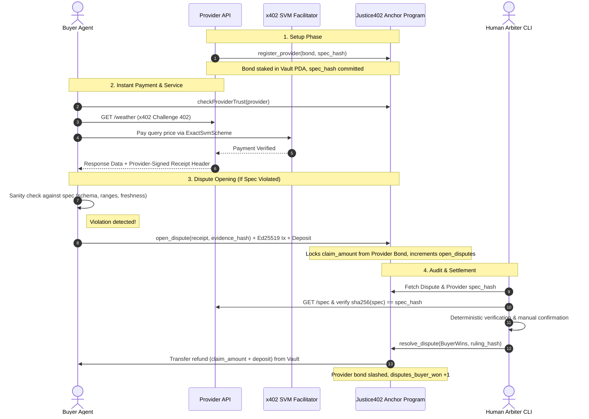

# Justice402: Insurance for x402 Payments on Solana

> **30-Second Summary**: HTTP [x402](https://x402.org) APIs settle payments instantly and irreversibly. But what happens if an API returns corrupted data, hallucinations, out-of-spec numbers, or times out? **Justice402 provides on-chain insurance—not escrow.** Providers stake a bond on Solana and commit to an immutable service spec (`spec_hash`). Every HTTP response carries a provider-signed receipt. If an answer violates the spec, the buyer opens an on-chain dispute within a time window. An arbiter audits the cryptographic proof and refunds the buyer directly out of the provider's bond.

---

## Live Deployments & Links

- **Live Dashboard**: [https://justice402-dashboard.vercel.app](https://justice402-dashboard.vercel.app) *(Placeholder)*
- **Hosted Provider API**: [https://api.justice402.dev](https://api.justice402.dev) *(Placeholder)*
- **Solana Devnet Program**: [`D8uK7oT6f1pcZzK2Dq1NhL7wdNp51sS5ZhuNy4wf8WYD`](https://explorer.solana.com/address/D8uK7oT6f1pcZzK2Dq1NhL7wdNp51sS5ZhuNy4wf8WYD?cluster=devnet) *(Live on Solana Devnet, settled in Wrapped SOL)*
- **GitHub Repository**: [https://github.com/nilanjanchavan/Justice402](https://github.com/nilanjanchavan/Justice402)
- **Live Devnet Demo Run Proof**: [`docs/DEMO_RUN.md`](docs/DEMO_RUN.md) & [`docs/demo-run.json`](docs/demo-run.json)

---

## Architecture Diagram



---

## Core Product Mechanics

1. **Insurance, Not Escrow**:
   Funds are never locked in escrow during the HTTP request. Instant payment is preserved.
2. **Provider Stake Bond**:
   Providers deposit collateral in USDC. A buyer spend policy refuses to purchase from unbonded or high-loss providers.
3. **Canonical 249-Byte Signed Receipt**:
   Cryptographically commits to provider, buyer, spec_hash, request_hash, response_hash, payment_reference, price, timestamp, and nonce.
4. **Ed25519 Instruction Introspection**:
   The Solana program introspects the transaction's instruction sysvar to verify the provider's signature on-chain with zero third-party trust.
5. **Human Arbiter First**:
   Deterministic verification CLI displays full audits and prompts the human arbiter. An AI arbiter advisor is future work.
6. **Anti-Griefing Protection**:
   Buyers post a `dispute_deposit` (1 USDC) returned on win/timeout, forfeited on provider win. Open disputes are capped at 3 per buyer.
7. **Permissionless Timeout**:
   If the arbiter fails to respond before the deadline, any caller can trigger `claim_timeout` to refund the buyer.

---

## Trust Assumptions & Known Limitations

> [!IMPORTANT]
> - **The Arbiter is a Trusted Party**: In this phase, the arbiter wallet has sole authority to rule `BuyerWins` or `ProviderWins`.
> - **Arbiter Liveness is a Trust Assumption**: If the arbiter goes offline, disputes must wait for the resolution timeout (e.g. 3 minutes on devnet) before settling.
> - **Clock Drift Tolerance**: Solana on-chain clock skew tolerance is bounded to 60 seconds.
> - **Immutable Spec per Account**: A provider commits to one immutable `spec_hash`. Updating a spec requires deploying a new provider account.

---

## Related Work & Prior Art

- **x402r (Reputation & Escrow)**: Proposed escrow schemes for x402 that add settlement delays and custodial risk. Justice402 solves this via post-payment bonded insurance.
- **ERC-4337 & Conditional Clawbacks**: Smart contract wallets with conditional clawbacks operate on account-abstraction layers. Justice402 operates natively on Solana using PDA vaults.
- **IETF ADRP (Automated Dispute Resolution Protocol)**: Explores standardized schemas for evidence exchange. Justice402 adopts ADRP-style deterministic spec auditing.
- **Chainlink DECO & Town Crier**: Oracle-based verification of TLS sessions. Justice402 uses direct provider-signed Ed25519 receipts, avoiding heavy zero-knowledge TLS proofs.

---

## Documentation Directory

- [**docs/DESIGN_DECISIONS.md**](docs/DESIGN_DECISIONS.md) — Comprehensive design choices, trade-offs, and alternatives considered.
- [**docs/CODE_WALKTHROUGH.md**](docs/CODE_WALKTHROUGH.md) — Line-by-line audit of every instruction, account constraint, and test mapping.
- [**docs/DEPLOY.md**](docs/DEPLOY.md) — Devnet deployment guide with verifiable Docker builds and `solana-verify`.
- [**docs/HOSTING.md**](docs/HOSTING.md) — Hosted Provider API production deployment and environment variables.
- [**docs/RECEIPT.md**](docs/RECEIPT.md) — Receipt format, field layout, and shared test vectors.
- [**docs/DEMO_RUN.sample.md**](docs/DEMO_RUN.sample.md) — Sample devnet demo execution trace.

---

## Quickstart (Devnet Demo)

```bash
# 1. Install dependencies & build
npm install
npm run build --workspaces

# 2. Run unit & integration test suites
npm test                    # Canonical receipt test vectors
npm run test:integration    # 26 Anchor program tests
npm run test:e2e            # End-to-end integration tests

# 3. Devnet Initialization & Demo
npm run init:devnet         # Idempotent devnet program initialization
npm run seed:devnet         # Registers Honest, Lying, and Subtle providers
npm run demo:devnet         # Runs real devnet purchase & dispute flow
```
